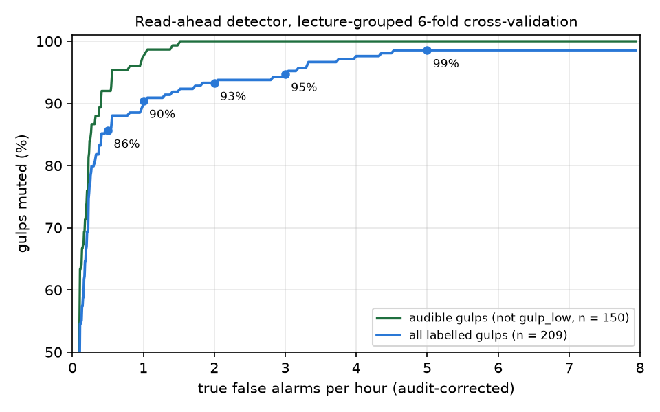
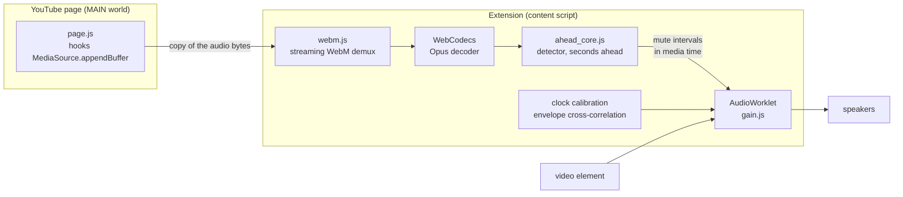

# Gulp Suppressor

A Chrome extension that **mutes a lecturer's swallowing sounds ("gulps") in YouTube lectures, in real time**, before they are heard. It is built for one channel: the Buders (BUders Boğaziçiliden Özel Ders) differential-equations playlist.

It started as a personal annoyance and became a small, end-to-end signal-processing and machine-learning project:
- hand-made data;
- a detector designed under a real-time constraint;
- bit-exact testbenches between Python and JavaScript;
- a statistically honest evaluation.

Hardware is the long-term target. The detector was kept simple on purpose (log-band energies, a comparator-style onset detector, a linear classifier) so it can later be ported to fixed point on an FPGA (Arty A7-100T).



| Setting (popup) | True false alarms / hour | Gulps muted (all labelled) | Audible gulps muted |
|---|---|---|---|
| Very cautious | 0.5 | 86 % | 92 % |
| Cautious | 1 | 90 % | 98 % |
| **Default** | **2** | **93 %** | **100 %** |
| Sensitive | 3 | 95 % | 100 % |
| Aggressive | 5 | 99 % | 100 % |

How these numbers were measured:
- 14.1 h of lectures (36 lectures) and 209 labelled gulps.
- Lecture-grouped 6-fold cross-validation.
- False alarms are corrected with two blind audits (see [Evaluation](#evaluation)).
- "Audible" means every gulp except those labelled `gulp_low` (barely audible).
- At the default setting, all 14 missed gulps are `gulp_low`.
- **The held-out test set (lectures 037–040, ~2 h) has not been touched yet.** These numbers are cross-validated, not held-out (see [Limitations](#limitations)).

## How it works



**Read-ahead.** YouTube buffers audio tens of seconds before it plays.
- `page.js` copies every audio append from the player's `SourceBuffer`.
- The extension demuxes and decodes it itself.
- It finds gulps **before** they are played.
- An `AudioWorklet` then mutes the matching media-time intervals with zero added latency.

The decoder's clock and the speakers' clock are aligned continuously: the energy envelopes of the two signals are correlated (time-delay estimation). In practice r ≈ 0.999 and the offset is about 2 ms.

If read-ahead is unavailable, a **live mode** runs the same detector on the outgoing stream with a 115 ms delay.

**Detector**, every 10 ms frame (25 ms Hann window, 16 kHz, 24 log-spaced bands from 100 Hz to 8 kHz, plus harmonicity and spectral flux):
1. **Onset detector.** A frame is an onset when its level is 6 dB above a tracked noise floor after 100 ms of quiet. In hardware this is a comparator and a counter. Secondary *re-anchors* are placed where the level jumps by 6 dB inside a sound, because many gulps start with a weak lead-in.
2. **Onset classifier.** L2-regularised logistic regression on the 100 ms spectro-temporal patch after each anchor (289 features). Comparing onsets with onsets, instead of every frame with gulps, removes a base rate of about 1 : 1700.
3. **Vetoes** (read-ahead only, because they need to see the future):
   - **Speech veto:** ≥ 43 dB above the floor within 200 ms.
   - **Breath rule:** low-band roughness, spectral tilt and LF peak, applied only to unvoiced, quiet sounds that could be either breath or gulp.
   - **Weak click before speech.**
   - **End-of-recording cut.**
4. **Mute** from the sound's onset minus 30 ms of pre-roll, with gain ramps.

The extension is active **only on videos from the Buders channel** (checked by channel ID on every navigation). On any other video the sound is not touched.

## Evaluation

The interesting part of this project was mostly about measurement, not model choice.

- **Event-level metrics.** The unit is a sound: a gulp counts as caught if any anchor in it fires. False alarms are counted per hour of audio, at fixed operating points.
- **Lecture-grouped cross-validation.** No lecture is ever scored by a model that saw it.
- **Model comparison and learning curve.** Logistic regression, small CNNs (with augmentation, and with a finer time-frequency input) and whole-sound classifiers all plateaued at about 69 % recall at 5 measured FA/h. The learning curve was flat. This pointed away from the model and towards the **labels**.
- **Blind audits.** Two rounds of the detector's alarms were re-listened blind, mixed with hidden positive and negative controls (12/12 controls correct in both rounds).
  - Round 1: **36 of 39** "false alarms" above the 5 FA/h threshold were real, unlabelled gulps.
  - Round 2: 8/10 and 15/30 in deeper score bands.
  - Gulp labels went from 153 to 212.
  - The false-alarm rate is now **audit-corrected**: unlabelled alarms are weighted by the gulp share measured in their score band (Clopper–Pearson intervals).
- **User-derived rules.** Breath/gulp cues proposed by the annotator (HF/LF ratio, LF level, LF fluctuation) were turned into a gated rule. That rule was checked on every labelled gulp so it removes none.
- **Bit-exact JS ↔ Python testbenches.**
  - `engine.js` was compared with the Python engine decision by decision (998/998 and 631/631).
  - The WebM demuxer was compared with ffprobe packet by packet (18001/18001).
  - The read-ahead path was tested end to end with MSE playback, gaps and seeks.

## Limitations

- **Selection bias.** Many labels were found by the detector itself (through the audits), so gulps it never fires on are under-represented. Recall is measured on *known* gulps.
- **Same-data tuning.** Thresholds and rules were tuned on the same 36 lectures. Cross-validation keeps the model honest, but not these choices.
- **Small audits.** The false-alarm correction rests on audits of 49 and 30 sounds. The deeper band's gulp share has a 95 % interval of about 31–69 %.
- **One speaker.** The detector is trained for one lecturer, one microphone and one room. It is not a general swallow detector, which is why it only runs on one channel.

**Next:** a blind held-out test on lectures 037–040, then a listening test in normal use.

## Repository layout

```
extension/        Chrome MV3 extension (load unpacked)
  page.js           MAIN-world hook: MediaSource/SourceBuffer, channel ID
  content.js        audio graph, settings, Buders-only gate
  webm.js           streaming EBML/WebM demuxer
  ahead.js          read-ahead controller (decoder, calibration, mute scheduling)
  ahead_core.js     analyzer over decoded segments + clock calibrator
  engine.js         the detector (same maths as tools/live.py)
  worklet.js, gain.js  AudioWorklet: live engine / media-time gain
  model.json        exported model + every constant the JS engine needs
  test/             Node + browser testbenches
tools/            Python: features, detectors, evaluation, audits, review tool (see tools/README.md)
models/           detector.json (trained weights and thresholds)
docs/img/         figures
```

## Usage

**Extension.**
1. Open `chrome://extensions` and turn on Developer mode.
2. Click "Load unpacked" and choose `extension/`.
3. Open a Buders lecture.

The popup sets sensitivity (the operating points above) and attenuation (−15 / −30 / −60 dB). It also shows the read-ahead status.

**Python tools** (Python 3.14, Windows paths in the docstrings; `torch` only for the CNN experiments):

```bash
python -m venv .venv
.venv/Scripts/pip install -r requirements.txt
.venv/Scripts/python tools/train_final.py      # retrain, write models/detector.json
.venv/Scripts/python tools/export_extension.py # write extension/model.json
.venv/Scripts/python tools/check_extension.py  # JS engine vs Python engine
```

Lecture audio is not distributed. The labels are (`data/labels`, `data/review`: 212 gulp labels plus the reviewed non-gulp sounds and both blind-audit keys). The tools expect the playlist's lectures as WAV files in `data/raw/`; `data/playlist_ids.txt` lists the video IDs.

## Roadmap

- [x] Offline detector and labelling/review tool
- [x] Real-time engine (Python, then JS AudioWorklet)
- [x] Read-ahead from YouTube's media buffer
- [x] Blind label audits and corrected evaluation
- [ ] Held-out test (lectures 037–040) and listening test
- [ ] Fixed-point, bit-true model and FPGA implementation (Arty A7-100T, I²S audio)

## License

MIT. See [LICENSE](LICENSE).
